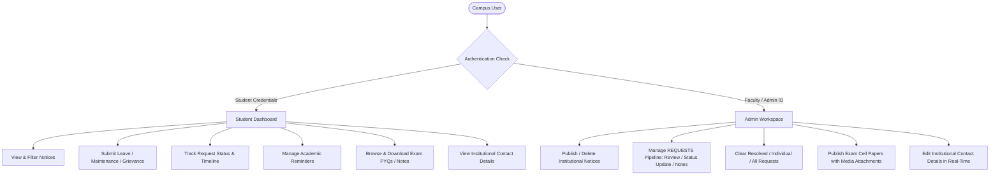
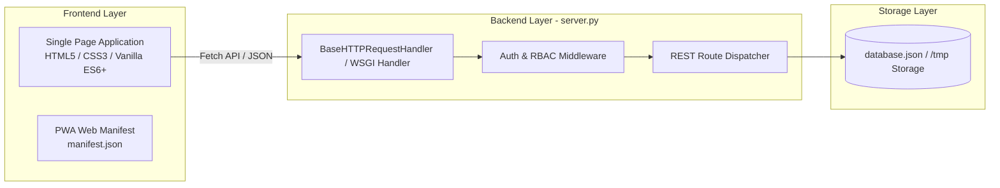

# Product Requirements Document (PRD)

## Project Name: CampusEase (Unified Academic & Campus Operations Portal)
**Document Version:** 1.0.0  
**Status:** Approved / Active Development  
**Author:** DeepMind Agentic Engineering  
**Target Release:** Production v1.0  

---

## 1. Executive Summary

### 1.1 Problem Statement
Higher education institutions often struggle with fragmented communication channels. Leave processing, room maintenance, exam material distribution, and academic notifications are typically scattered across physical notice boards, paper applications, and unmonitored messaging groups. This leads to operational delays, lack of accountability, and student frustration.

### 1.2 Vision & Objective
**CampusEase** is a centralized, lightweight, institutional web portal designed to streamline daily campus life for both students and faculty/administrative staff. It provides structured request workflows, instant official communication, examination material repositories, and personal academic task tracking under a unified, professional user interface.

### 1.3 Key Value Propositions
- **Unified Academic Hub:** Single login for hostel leaves, grievances, exam resources, notices, and reminders.
- **Transparent Request Lifecycle:** Full audit trail for student requests with real-time status updates (`Pending`, `In Progress`, `Resolved`, `Rejected`).
- **Zero-Dependency Architecture:** Ultra-lightweight vanilla frontend and Python-native backend that operates on low-resource hardware or serverless infrastructure without heavyweight external frameworks.
- **Institutional Design Standard:** Clean, distraction-free aesthetic with strict accessibility, zero unnecessary visual clutter, and strict role segregation.

---

## 2. User Personas & Roles

### 2.1 Persona 1: Student
- **Profile:** Enrolled undergraduate or postgraduate student (hosteller or day scholar).
- **Core Needs:**
  - Submit hostel out-pass or leave applications without manual paperwork.
  - Report maintenance defects (e.g., electrical, plumbing) in dorms or classrooms.
  - Download official exam schedules, syllabus, and past question papers.
  - Set personal deadlines for assignments and lab submissions.

### 2.2 Persona 2: Institutional Administrator / Faculty
- **Profile:** Faculty advisor, hostel warden, exam controller, or administrative officer.
- **Core Needs:**
  - Broadcast official announcements instantly across departments.
  - Triage, process, annotate, and resolve incoming student requests.
  - Clear resolved backlog to maintain clean operational queues.
  - Upload study materials, previous year papers (PYQs), and exam notifications with attachments.
  - Keep institutional contact numbers and office hours updated.

---

## 3. Functional Specifications

### 3.1 Authentication & Role-Based Access Control (RBAC)
- **Student Sign-In & Sign-Up:**
  - Identifiers: Roll number, password, full name, branch (e.g., `CSE`, `ECE`, `CE`), hosteller flag, room number (if hosteller).
- **Admin Sign-In & Sign-Up:**
  - Identifiers: Employee ID (e.g., `FAC-01`), password, full name.
- **Session Management:**
  - Active session persisted in client storage (`localStorage`).
  - Graceful sign-out with state cleanup.
  - Strict input sanitization with no pre-filled credentials.

### 3.2 REQUESTS (Service & Administrative Pipeline)
The service pipeline allows students to lodge formal petitions and admins to act upon them:
1. **Request Types:**
   - **Leave Application:** `from_date`, `to_date`, `reason`, student details.
   - **Hostel / Facility Maintenance:** `category` (Electrical, Plumbing, Furniture, Network), `location` (Hostel block & room / Lab), `description`.
   - **Academic Grievance:** `category` (Coursework, Faculty, Timetable, Examination), `statement`.
2. **Lifecycle States:**
   - `pending` (Default upon submission)
   - `in_progress` (Under review by warden/faculty)
   - `resolved` (Action completed)
   - `rejected` (Declined with mandatory reason)
3. **Audit History:**
   - Every status transition creates an immutable log entry with timestamp and remark.
4. **Admin Queue Maintenance:**
   - Single-item deletion ("Clear This Request").
   - Bulk status clearing ("Clear Completed").
   - Complete reset ("Clear All").

### 3.3 Notices & Bulletins
- **Broadcast System:** Centralized notification feed chronologically ordered.
- **Categorization:** `academic`, `hostel`, `exam`, `general`.
- **Administrative Privileges:** Admin users can draft, publish, and delete notices with immediate propagation to all connected clients.

### 3.4 Exam Cell & Academic Material Repository
- **Categories:** `pyq` (Previous Year Papers), `syllabus`, `notes`, `timetable`.
- **Branch & Semester Filtering:** Fast selection across 8 academic semesters and institutional departments.
- **Media Attachments:**
  - Support for local file uploads (Base64 encoding) and remote URLs.
  - In-browser preview for image formats.
  - One-click file download button for student offline access.

### 3.5 Personal Academic Reminders
- Student-specific task list with customizable titles and due dates.
- Automated chronological sorting and status markers (e.g., "Due Soon", "Overdue").
- Complete CRUD operations isolated per user ID.

### 3.6 Institutional Contact Us Module
- Dedicated modal accessible from the portal footer.
- **Fields:** Official email, desk phone, physical office room, operating hours, 24/7 security/emergency helpline.
- **Admin In-Place Editor:** Administrators can edit any field directly within the modal and save changes to the central database in real time.

---

## 4. System Architecture & Technical Stack

| Component | Technology | Rationale |
| :--- | :--- | :--- |
| **Frontend** | HTML5, Modern CSS, Vanilla JavaScript (ES6+) | Instant load speeds (<200ms), zero compilation step, 100% portable. |
| **Backend** | Python 3.10+ Standard Library (`http.server`, `urllib.parse`, `json`) | Zero external package bloat, run anywhere without `pip install` friction. |
| **Serverless Bridge** | Dual `BaseHTTPRequestHandler` and WSGI export | 100% compatible with both persistent servers (Render/Railway) and serverless CDNs (Vercel). |
| **Data Persistence** | Normalized JSON document store (`database.json` / `/tmp` runtime bridge) | Human-readable, atomic reads/writes, zero SQL database provisioning overhead for pilot deployment. |
| **Deployment** | Vercel (`vercel.json`), Render / Railway (`Procfile`), or native script | Multi-cloud ready with zero lock-in. |

---

## 5. API Interface Specification

### 5.1 Authentication Endpoints
- `POST /api/login`: Authenticate student or admin credentials.
- `POST /api/register`: Register new student or admin profile.

### 5.2 Notices Endpoints
- `GET /api/notices`: Fetch active institutional notice list.
- `POST /api/notices`: Publish a new announcement (Admin only).
- `DELETE /api/notices/{id}`: Delete an announcement (Admin only).

### 5.3 Requests Endpoints
- `GET /api/requests?who={name}&role={role}`: Query requests filtered by ownership or full admin queue.
- `POST /api/requests`: Submit a new leave, maintenance, or grievance petition.
- `PATCH /api/requests/{id}`: Update request status and append history note.
- `DELETE /api/requests/{id}`: Delete an individual request record.
- `DELETE /api/requests?status={status}`: Bulk delete requests matching status (e.g., `status=resolved`).

### 5.4 Exam Cell Endpoints
- `GET /api/exam?branch={branch}&sem={sem}`: Retrieve study materials matching filters.
- `POST /api/exam`: Upload new question paper or notes with media payload.
- `DELETE /api/exam/{id}`: Delete an exam publication.

### 5.5 Contact Details Endpoints
- `GET /api/contact`: Retrieve current institutional contact metadata.
- `POST /api/contact`: Persist updated contact information (Admin only).

---

## 6. Non-Functional Requirements (NFR)

### 6.1 Performance & Latency
- First Contentful Paint (FCP) under **0.8 seconds** on standard 4G connections.
- API response turnaround under **50ms** for local/serverless execution.
- Total static bundle size strictly below **100 KB** (excluding user media).

### 6.2 Design & Aesthetics Guidelines
- **Institutional Palette:** Slate Navy (`#0f172a`), Crisp Neutral Borders (`#e2e8f0`), Subtle Status Badges (Green, Amber, Red).
- **Strict Anti-Patterns:**
  - No purple neon gradients or whimsical card hover flips.
  - No pill-shaped buttons; strict 6px border-radius standard.
  - No decorative emojis; 100% semantic SVG line icons only.
  - No fake reviews or prefilled form states.

### 6.3 Security & Data Integrity
- Role checks enforced on both client-side views and backend route handlers.
- Input validation on all date ranges, roll numbers, and payloads.
- Base64 file upload limits to avoid server memory exhaustion.
- Serverless read-only filesystem handling via `/tmp` seeding to guarantee 0% crash rate on edge runtimes.

---

## 7. Implementation Status & Roadmap

| Feature / Module | Status | Version |
| :--- | :--- | :--- |
| Core Student & Admin Authentication | Completed | v1.0 |
| Notice Board & Category Filters | Completed | v1.0 |
| REQUESTS Pipeline with Full Audit History | Completed | v1.0 |
| Admin Request Clearing (Single & Bulk) | Completed | v1.0 |
| Personal Student Reminders | Completed | v1.0 |
| Exam Cell with Media Upload & Download | Completed | v1.0 |
| Dynamic Admin-Editable Contact Us Modal | Completed | v1.0 |
| Vercel Serverless Entrypoint & `vercel.json` | Completed | v1.0 |
| Persistent Relational DB Migration (PostgreSQL / SQLite) | Planned | v2.0 |
| Automated Email / SMS Notifications for Approved Leaves | Planned | v2.0 |
| Multi-Campus Role Hierarchies (Dean, HOD, Warden) | Planned | v2.1 |
