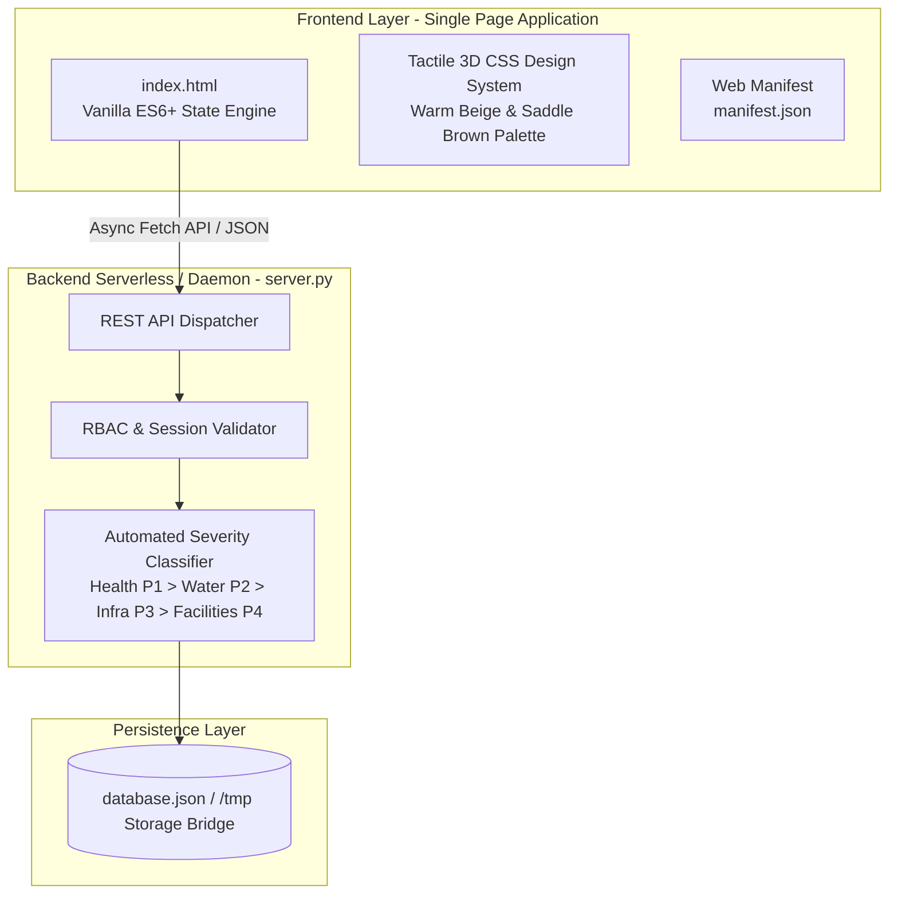
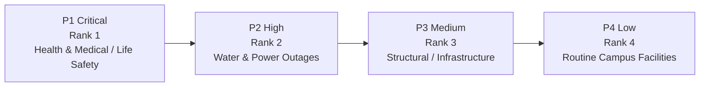

# CampusEase

> **Unified Academic Operations & Campus Incident Management Portal**

[](https://www.python.org/)
[](https://developer.mozilla.org/en-US/docs/Web/JavaScript)
[](https://github.com/UMESH-PATRA/CampusEase)
[](https://vercel.com/)
[](LICENSE)

**CampusEase** is a lightweight, zero-dependency institutional web portal engineered to unify academic administration, student clearance workflows, examination resources, and campus emergency/incident response. Designed with an enterprise-grade aesthetic, role-based access control (RBAC), and automated triage algorithms, CampusEase replaces paper slips and disjointed chat groups with an auditable, transparent operational hub.

---

## Table of Contents

- [Key Value Propositions](#key-value-propositions)
- [System Architecture](#system-architecture)
- [Core Features & Modules](#core-features--modules)
  - [Student Portal](#1-student-portal)
  - [Faculty & Admin Operations Desk](#2-faculty--admin-operations-desk)
  - [Incident Management & Severity Protocol](#3-incident-management--severity-protocol)
  - [Live Dashboard Metrics](#4-live-dashboard-metrics)
- [Tech Stack & Design Philosophy](#tech-stack--design-philosophy)
- [Repository Structure](#repository-structure)
- [Quick Start Guide (Local Setup)](#quick-start-guide-local-setup)
- [Deployment Guide](#deployment-guide)
  - [Vercel (Serverless)](#deploying-to-vercel)
  - [Render / Railway / Heroku](#deploying-to-render--railway--heroku)
- [REST API Reference](#rest-api-reference)
- [Contributing](#contributing)
- [License](#license)

---

## Key Value Propositions

* **Zero-Dependency Architecture:** Powered strictly by standard library Python 3 (`http.server`, `urllib.parse`, `json`) and vanilla browser standards (HTML5/CSS3/ES6+). Runs anywhere without `npm install` or `pip install` overhead.
* **Instant Sub-Second Latency:** Ultra-lean static footprint (<130 KB total bundle) delivering First Contentful Paint (FCP) under 300ms.
* **Automated Incident Priority Triage:** Enforces a life-safety triage protocol where acute health crises and utility failures automatically supersede routine maintenance.
* **Dual Execution Bridge:** Acts as both a standalone stateful HTTP daemon for local/VPS hosting and a WSGI/serverless handler for Vercel/AWS Lambda with automated `/tmp` read-write seeding.
* **Enterprise Design Standard:** High-contrast warm architectural palette (beige, crisp white, saddle brown, light yellow), tactile 3D button depth effects, and 100% semantic monochrome SVG icons (strictly zero emojis, zero pill buttons).

---

## System Architecture



---

## Core Features & Modules

### 1. Student Portal
* **Clearance & Petitions (REQUESTS):** File leave applications, campus gate passes, hostel maintenance requests, and academic grievances with structured fields.
* **Real-Time Lifecycle Stepper:** Visual step-tracker (`Submitted` $\rightarrow$ `Under Review` $\rightarrow$ `Approved / Finalized` or `Rejected`) with official proctor audit remarks.
* **Incident & Hazard Registration:** Immediate logging of medical trauma, electrical faults, pipe bursts, or facilities hazards with photo attachments and live protocol instructions.
* **Examination Material Hub:** Browse and download Previous Year Papers (PYQs), course portions, syllabus, and study notes with branch and semester filtering.
* **Personal Reminders:** Student task list for upcoming assignment deadlines, lab submissions, and exams.
* **Campus Announcements:** Centralized notice board displaying authenticated administrative circulars.

### 2. Faculty & Admin Operations Desk
* **REQUESTS Command Pipeline:** Triage incoming petitions, update statuses with single-click transitions, append official remarks, and prune completed queues with bulk clearing tools.
* **Incident Resolving Dashboard:** Comprehensive triage center featuring real-time KPI strips, status progression (`Move to Triage` $\rightarrow$ `Dispatch Team` $\rightarrow$ `Mark Resolved` $\rightarrow$ `Dismiss`), and field remark logging (e.g., doctor ETA, maintenance dispatch).
* **Official Circular Publishing:** Draft, broadcast, and retract university notices with instant client-side propagation.
* **Exam Cell Distribution Desk:** Upload datesheets, question papers, and study guides with embedded documents or image files.
* **Live Institutional Contact Editor:** In-place modal editor allowing administrators to update office room locations, official emails, telephone numbers, and 24/7 emergency helplines in real time.

---

### 3. Incident Management & Severity Protocol

CampusEase implements an automated priority classification engine. Incidents are sorted dynamically to ensure life safety and urgent health crises are immediately surfaced to the top of all feeds:



| Priority Rank | Classification | Trigger Categories | Institutional Action Protocol |
| :--- | :--- | :--- | :--- |
| **P1 - Critical** | **Emergency (Life & Health)** | `health`, `safety` | Immediate Medical Officer, Ambulance, & Chief Security dispatch. Pins to top of queue. |
| **P2 - High** | **Utility Crisis** | `water`, `power` | Plumbing Emergency Squad & Electrical Sub-panel crews dispatched within 15 minutes. |
| **P3 - Medium** | **Structural Hazard** | `infrastructure` | Civil & carpentry maintenance queued for inspection. |
| **P4 - Low** | **General Facility** | `facilities` | Standard maintenance work-order batching. |

---

### 4. Live Dashboard Metrics

The dynamic KPI metrics strip in the dashboard displays real-time institutional health:
* **Pending Clearance Requests:** Active student applications awaiting determination.
* **Active Circulars:** Total verified notices published across departments.
* **Incidents Recorded / Active:** Real-time count of unresolved emergency and facility logs.
* **Incidents Resolved:** Verified safety and maintenance closures with one-click navigation to the resolution desk.

---

## Tech Stack & Design Philosophy

| Layer | Component | Specification |
| :--- | :--- | :--- |
| **Frontend** | Single Page Application | Semantic HTML5, Modern CSS Variables, Vanilla ES6+ (Zero libraries, zero React/Vue bloat). |
| **Backend** | Native Python HTTP Server | Python 3.10+ standard library (`http.server`, `urllib.parse`, `json`). |
| **Serverless Bridge** | Dual Environment Adapter | WSGI & `BaseHTTPRequestHandler` export compatible with Vercel and edge functions. |
| **Data Storage** | Normalized JSON Store | `database.json` with runtime `/tmp` fallback for immutable serverless containers. |
| **Aesthetic System** | Architectural Palette | Warm Beige (`#fbf7f0`, `#f4ede3`), Crisp White cards (`#ffffff`), Saddle Brown (`#824d26`), and Canary Yellow (`#fef9c3`). |
| **Component Depth** | Tactile 3D Styling | Multi-layered box shadows (`0 2px 4px rgba(...)`, `0 1px 0 inset`), bevelled rims, and sunken active states (`--radius: 6px`). |

---

## Repository Structure

```text
CampusEase/
├── index.html            # Unified Single-Page Application (HTML, CSS & Client JS)
├── server.py             # Python HTTP Server, REST API Router & Serverless Bridge
├── database.json         # Seed JSON flat-file database
├── vercel.json           # Vercel URL rewrite rules (/api/* -> /server.py)
├── Procfile              # Process declaration for Render, Railway & Heroku
├── requirements.txt      # Python runtime environment descriptor (Standard library)
├── manifest.json         # Progressive Web App (PWA) manifest
├── PRD.md                # Comprehensive Product Requirements Document
├── .gitignore            # Git exclusion rules (__pycache__, temporary artifacts)
└── README.md             # Project documentation & operational handbook
```

---

## Quick Start Guide (Local Setup)

### Prerequisites
* **Python 3.10 or higher** installed on your system.
* Any modern web browser (Chrome, Edge, Firefox, Safari).

### 1. Clone the Repository
```bash
git clone https://github.com/UMESH-PATRA/CampusEase.git
cd CampusEase
```

### 2. Launch the Application
```bash
# On Windows
py server.py

# On macOS / Linux
python3 server.py
```

### 3. Open in Browser
Navigate to:
```text
http://localhost:3000
```

### 4. Demo Login Credentials

You can sign up with your own credentials or use the pre-seeded accounts:

| Role | Identifier | Password | Access Level |
| :--- | :--- | :--- | :--- |
| **Student** | `220101` (Roll No) | `student123` | Student Dashboard, Applications, Incident Logger, Exam Cell |
| **Faculty / Admin** | `FAC-01` (Emp ID) | `admin123` | Full Operations Desk, Incident Command, Notice Publisher, Editor |

---

## Deployment Guide

### Deploying to Vercel
CampusEase is pre-configured for instant deployment on [Vercel](https://vercel.com/):

1. Push the code to your GitHub repository.
2. Sign in to **Vercel** and select **Add New Project** $\rightarrow$ **Import Git Repository**.
3. Keep default settings (Vercel automatically detects [`vercel.json`](vercel.json) and routes API requests to [`server.py`](server.py)).
4. Click **Deploy**. Your portal will be live in under 30 seconds with automated SSL.

### Deploying to Render / Railway / Heroku
The included [`Procfile`](Procfile) declares:
```text
web: python server.py
```
1. Connect your repository to **Render** or **Railway**.
2. Select **Web Service** with a Python runtime.
3. Set the start command to `python server.py`.
4. Deploy!

---

## REST API Reference

| Method | Endpoint | Description | Access |
| :--- | :--- | :--- | :--- |
| `POST` | `/api/auth/login` | Authenticate student or admin credentials | Public |
| `POST` | `/api/auth/signup` | Register new student or admin profile | Public |
| `GET` | `/api/notices` | Fetch active campus notices | Authenticated |
| `POST` | `/api/notices` | Publish institutional announcement | Admin Only |
| `DELETE` | `/api/notices/:id` | Remove campus circular | Admin Only |
| `GET` | `/api/requests` | List clearance requests (filtered by user or all) | Authenticated |
| `POST` | `/api/requests` | Submit leave, gate-pass, or complaint | Student |
| `PATCH` | `/api/requests/:id/status` | Advance status (`pending`, `in_progress`, `resolved`, `rejected`) | Admin Only |
| `POST` | `/api/requests/:id/notes` | Append official remark to request history | Admin Only |
| `DELETE` | `/api/requests/:id` | Remove single clearance record | Admin Only |
| `DELETE` | `/api/requests` | Bulk clear completed requests | Admin Only |
| `GET` | `/api/incidents` | List priority-sorted campus incidents | Authenticated |
| `POST` | `/api/incidents` | Register incident with automated priority mapping | Student / Staff |
| `PATCH` | `/api/incidents/:id/status` | Update incident resolution state | Admin Only |
| `POST` | `/api/incidents/:id/notes` | Log dispatch remarks (doctor ETA, repair logs) | Admin Only |
| `DELETE` | `/api/incidents/:id` | Delete incident log record | Admin Only |
| `DELETE` | `/api/incidents` | Bulk clear resolved incidents | Admin Only |
| `GET` | `/api/exam` | Retrieve exam materials by branch and semester | Authenticated |
| `POST` | `/api/exam` | Publish exam datesheets, PYQs, and notes with media | Admin Only |
| `DELETE` | `/api/exam/:id` | Delete exam publication | Admin Only |
| `GET` | `/api/reminders` | Fetch personal academic task list | Student |
| `POST` | `/api/reminders` | Add personal task reminder | Student |
| `DELETE` | `/api/reminders/:id` | Mark task as completed | Student |
| `GET` | `/api/contact` | Fetch official campus contact & emergency numbers | Public |
| `POST` | `/api/contact` | Update institutional contact details in real time | Admin Only |

---

## Contributing

Contributions are welcome! Please follow these steps:
1. Fork the Project.
2. Create your Feature Branch (`git checkout -b feature/NewFeature`).
3. Commit your Changes (`git commit -m 'feat: Add NewFeature'`).
4. Push to the Branch (`git push origin feature/NewFeature`).
5. Open a Pull Request.

---

## License

Distributed under the **MIT License**. See `LICENSE` for more information.

---

<p align="center">
  <b>Built with simplicity, speed, and precision for modern university ecosystems.</b>
</p>
